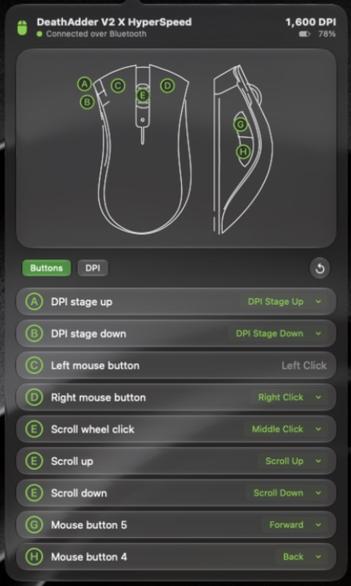
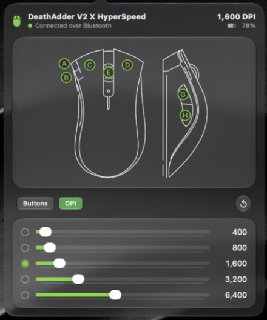
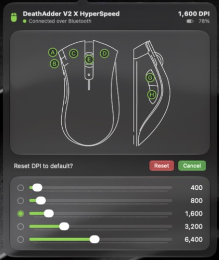

# Adder

A menu bar app for macOS that configures the Razer DeathAdder V2 X HyperSpeed over Bluetooth.
Razer Synapse for this mouse is Windows only, so on a Mac its buttons and DPI stages cannot
be changed. Adder does those two things and nothing else.

| Buttons | DPI | Reset |
|---|---|---|
|  |  |  |

## What it does

- **Button bindings.** Each button can be a mouse action, a DPI action, a macOS action
  (Mission Control, Desktop Left and Right, Back, Forward, and others), an Apple Shortcut,
  or disabled.
- **DPI stages.** Five stages from 100 to 14,000 DPI, and which one is active. A change
  made with the mouse's own DPI buttons shows up in the app while the popover is open.
- **Reset.** One icon resets the tab on show, after a confirmation.
- **Status.** Connection state, current DPI, and battery level.

The letters on the diagram (A to H) match Razer's guide for this mouse.

## Requirements

- macOS 27.2 or later, Xcode 27.2 or later.
- The mouse paired in **Bluetooth** mode (switch underneath set to the Bluetooth symbol).
  The 2.4 GHz dongle mode is not supported.
- Bluetooth permission for Adder, asked for on first launch. No Accessibility or Input
  Monitoring permission is needed.

## Build and run

```bash
xcodebuild -scheme razer-mice-driver -configuration Debug -destination 'platform=macOS' -derivedDataPath build build
```

```bash
open build/Build/Products/Debug/Adder.app
```

Adder has no window and no Dock icon. Left-click the mouse icon in the menu bar to open
it, right-click to quit.

## How it works

In Bluetooth mode the mouse exposes no HID configuration channel. Settings go over a
Razer vendor GATT service, and a binding is a small action block written into the mouse
itself. That is why most bindings keep working when Adder is not running.

Two things do depend on Adder running:

- **Apple Shortcuts.** The mouse cannot run a shortcut, so the button is bound to a
  reserved key combination (Control, Option, Shift, Command with F13 to F20) and Adder
  runs the shortcut when it hears that key.
- **Reapplying bindings.** This firmware cannot report its bindings back and may forget
  them after a power cycle, so Adder writes the saved ones again on every connect.

`CLAUDE.md` has the layout of the code and the rules a change must not break.

## Known limits

- **The two DPI buttons (A and B) are unconfirmed.** Their firmware slots are taken from
  Razer's other mice with two index-finger buttons. The mouse accepts the writes, but it
  cannot read them back, so this has not been proven on this model.
- **The left button is never remapped,** so a bad binding cannot leave the mouse unusable.
- **A stuck Control key.** A button bound to an action that includes Control can leave
  Control held if its binding is changed mid-press. Every click then acts as a right
  click. Switching the mouse off and on clears it.
- **Not sandboxed, not notarized.** It is built to run locally.

The session log is at `~/Library/Logs/Adder/adder.log`.

## Credits and license notes

- The Bluetooth protocol comes from the [OpenSnek](https://github.com/gh123man/OpenSnek)
  project's notes (Apache-2.0). OpenSnek is a fuller app for several Razer mice; this
  model is not on its supported list.
- The diagram's outline (`razer-mice-driver/Resources/MouseLineArt.json`) is generated
  from "Mouse - Razer DeathAdder" by [gimora](https://sketchfab.com/gimora) on Sketchfab,
  licensed CC BY-NC-SA 4.0. Because of that file, this project is for personal,
  non-commercial use.
- Razer and DeathAdder are trademarks of Razer Inc. This project is not affiliated with
  or endorsed by Razer.
